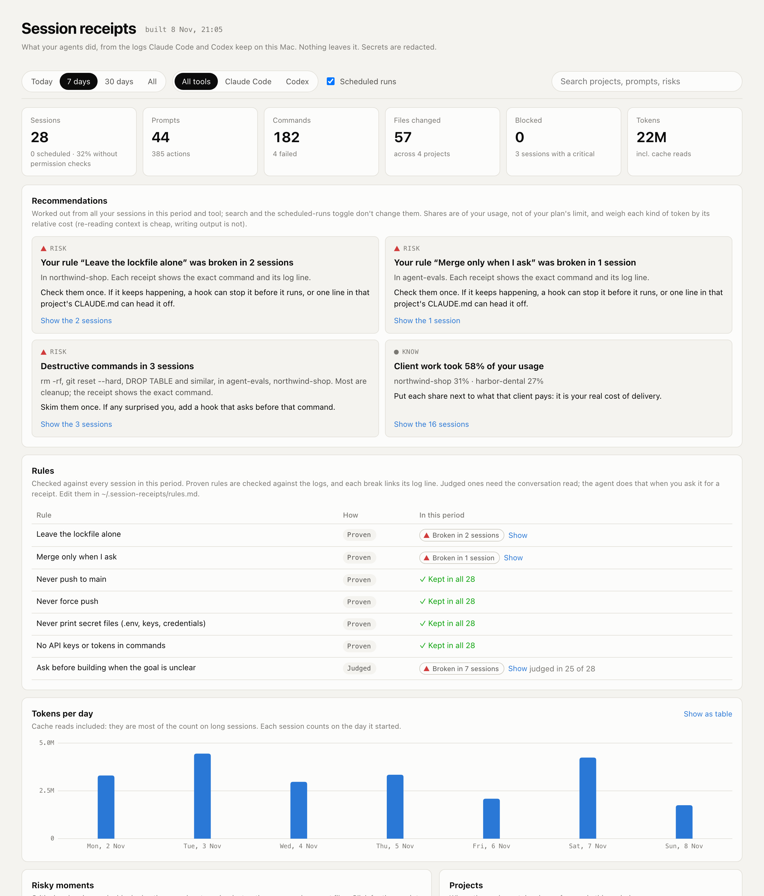
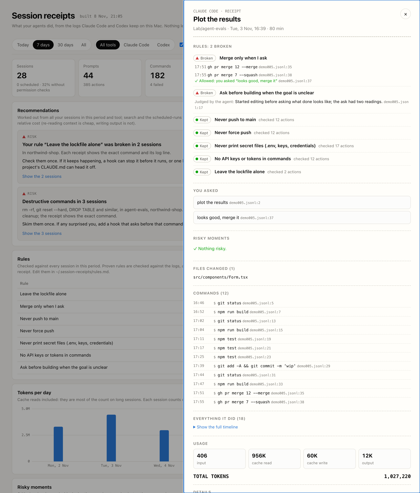

# Session receipts

[](https://github.com/AIwithDiego/session-receipts/actions/workflows/tests.yml)

**A receipt for every Claude Code and Codex session: what you asked, what the agent did, and whether it kept your rules, with the log line as proof.**

Coding agents do a lot while you look away: they edit files, run commands, push branches and merge pull requests. Both Claude Code and Codex already log every step on your machine. Session receipts reads those logs and turns each session into one page of evidence. It works as a skill in both tools, as a live dashboard, or from the command line, and it needs nothing but Python.



## What a receipt shows

- **What you asked**, prompt by prompt.
- **What the agent did**: files changed, commands run (and which failed), what a hook, a permission check or you blocked.
- **Risky moments**: pushes to main, force pushes, destructive commands, secret files touched, scripts piped to a shell.
- **Your rules, kept or broken.** Each break links the exact log file and line, and "unless asked" rules show the prompt that allowed it.
- **Usage in tokens**, split into input, cache and output. It reports tokens, not dollars: on a flat-rate plan, API prices would be the wrong number.

Across sessions, the dashboard adds recommendations: scheduled runs that reload their whole context every time, commands that keep failing, rules that keep breaking, and how much of your usage went to client work.



Every fact on a receipt keeps the log file and line it came from. A receipt is evidence you can check, not a summary you have to trust.

## Install

As a skill (one folder, same SKILL.md format for both tools):

```sh
git clone --branch v1.0.0 --depth 1 https://github.com/AIwithDiego/session-receipts ~/.claude/skills/session-receipts   # Claude Code
ln -s ~/.claude/skills/session-receipts ~/.agents/skills/session-receipts                     # Codex, same copy
```

To update, pick the new release on purpose: `git -C ~/.claude/skills/session-receipts fetch --tags && git -C ~/.claude/skills/session-receipts checkout <tag>`. A skill is code your agent runs, so it only changes when you say so.

Then ask either agent for **"receipts for today"**. It lists the day's sessions, judges your plain-language rules against the logs, records each verdict with its log line, and opens the dashboard.

Once a week, ask for **"receipts for the week"**: breaks first, each with its log line. In our own trial week that was the run that caught what mattered (see [LEARNINGS.md](LEARNINGS.md)).

Without an agent, run it from the folder:

```sh
python3 run.py serve --open          # live dashboard at http://localhost:4747
python3 run.py serve --install       # keep it running from login on macOS (--uninstall to undo)
python3 run.py dashboard --open      # or a static copy in ~/.session-receipts, no server
python3 run.py read today            # one line per session (or yesterday, week, YYYY-MM-DD)
python3 run.py read 2026-11-05 --json        # full detail, secrets redacted
python3 run.py judge today           # evidence for the judged rules (what the agent reads)
python3 run.py verdict --batch -     # record kept or broken, with the log line
python3 run.py forget --before 2026-09-01    # delete old receipts
python3 run.py status                # is the live dashboard running
```

Try it on made-up data first: `python3 scripts/demo.py` builds the dashboard in the screenshots.

Needs Python 3.10 or newer, nothing else. Reads `~/.claude/projects` (Claude Code) and `~/.codex/sessions` (Codex).

## Your rules

Write your rules in `~/.session-receipts/rules.md`, one per line, in plain language. Add a check in backticks and the rule is proven from the logs, with the log line as evidence; leave it out and the rule is judged by the agent when you ask for a receipt: it reads the session's evidence (`judge`), decides kept or broken, and records it with the log line (`verdict`). Not sure means not recorded, so the receipt says "not judged yet" rather than guessing.

```md
- Never push to main `push-main`
- Merge only when I ask `command: \bgh\s+pr\s+merge\b unless asked: \bmerge`
- Never print secret files `secret-files`
- No API keys or tokens in commands `secrets`
- Leave the lockfile alone `edit: package-lock.json`
- Ask before building when the goal is unclear
```

Checks: `push-main`, `force-push`, `secret-files`, `secrets`, `command: <regex>`, `file: <glob>`, `edit: <glob>`, each optionally followed by `unless asked: <regex>` (allowed when an earlier prompt in the session matched). Without a rules file, `receipts/assets/rules.example.md` is used.

Two kinds of rule, on purpose. A **proven** rule has a check the code runs against every command and file, so its verdict comes from the log, not an opinion. The checks are patterns, not a shell parser, so each break shows the exact command for you to confirm. They look at what the shell runs: quoted text with a space in it (a commit message, a search pattern, `python -c` code) and heredocs fed to a program are data, unless `sh -c`, `eval`, `ssh`, a pipe into a shell or `$(...)` runs them. The `secrets` check reads quoted text too (it skips only heredocs fed to a program), so a fake test key in a command counts.

What that means: the checks catch a careless agent, not one trying to hide. Code inside `python -c` or `node -e` is not read, and a command built at run time can slip past any pattern. Use receipts to see what happened; use hooks, permissions and branch protection to stop it. A **judged** rule ("ask before building when the goal is unclear") needs the conversation read, so the agent running the skill reads the evidence, decides, and must cite the log line for every break. Neither kind is guessed from the wording.

## Keeps history

Claude Code deletes session logs after 30 days. Every build keeps a redacted copy of each receipt in `~/.session-receipts/archive/`, so your history keeps growing after the raw logs are gone, without keeping the raw logs (which can hold secrets) any longer.

## Privacy

Session receipts reads logs that already sit on your computer and writes its results there too; the tool itself sends nothing anywhere. If you ask an agent for receipts (the skill), that agent's model sees the redacted receipts, the same way it sees anything else you work on with it. That means prompts from earlier sessions are sent again to your agent's model provider. If a client's work runs under specific terms (a zero-retention or enterprise account), run the skill under the same account, or use the dashboard, which involves no model.

Secrets are redacted before anything is written or shown: API keys and tokens in the usual formats (Anthropic, OpenAI, GitHub, AWS, Stripe, Slack, Google, Supabase and more), private keys, JWTs, passwords in URLs, Authorization and Cookie headers, `?token=` style query values, `--password` flags and `NAME_KEY=value` pairs. Text is redacted before it is cut short, so a secret can't survive by being split. When the patterns improve, the archive on disk is scrubbed again on the next build. `tests/test_leaks.py` plants secrets in every place a log can carry them and fails if one reaches the dashboard, the archive, the live server or `read --json`. Redaction is best effort, not a guarantee: a password typed as plain text with nothing around it looks like any other word.

Everything is written to `~/.session-receipts`, readable only by you (folders 0700, files 0600). The live dashboard listens on 127.0.0.1 only and refuses other host names and cross-site requests. A page can only read from it; nothing a request sends changes your rules, verdicts or receipts. Loopback is not a login, though: on a Mac shared with other user accounts, they could read it too, so use the static `dashboard` command there instead of `serve`.

**GDPR.** Used on your own hobby projects, it's a personal activity. Used for work, the receipts can hold personal data you process professionally, and the rest of this section applies. Watch for other people's personal data in your sessions: a client's customer records, colleagues' names and emails, support tickets or database dumps you worked on. That data then also lands in your receipts and in the archive, which keeps them after the raw logs are deleted. If you do client work, treat `~/.session-receipts` like the client data itself: keep it on an encrypted disk, don't share screenshots of it, and delete receipts you no longer need (for example `python3 run.py forget --before` a date 12 months back, once a month). If you run it on a shared or managed machine, check with whoever is responsible for data protection there.

**Rolling it out to a team.** If an organisation uses receipts to review what its staff's agents did, that is monitoring of employees: their prompts are their personal data. It needs a lawful basis, telling the staff, likely a DPIA (GDPR Art. 35), and in some countries works-council consultation. Talk to your data protection contact first.

Security issues: see [SECURITY.md](SECURITY.md).

## How it works

```
~/.claude/projects/**.jsonl ─┐                    ┌─> receipts (redacted) ─> dashboard / live server / archive
                             ├─> one session shape ┤
~/.codex/sessions/**.jsonl ──┘                    └─> rules checked ─> verdicts from the agent (judged rules)
```

- `receipts/claude_code.py`, `receipts/codex.py`: read each tool's log format into one shape (`receipts/model.py`), every fact with its file and line.
- `receipts/rules.py`: proven rules; `receipts/judge.py` and `receipts/verdicts.py`: judged rules.
- `receipts/redact.py`: secret redaction, applied before anything is written, served or cut short.
- `receipts/dashboard.py`, `receipts/server.py`, `receipts/assets/dashboard.html`: the static build, the localhost server and the page.
- Decisions and their reasons: `docs/decisions/`.

## Tests

```sh
python3 -m unittest
```

All tests run on synthetic logs. `tests/test_leaks.py` is the one to read first: it plants secrets everywhere a log can carry them and fails if any reaches an output.

## License

MIT. Built by [Diego Bauer](https://github.com/AIwithDiego) at AIwithDiego.
