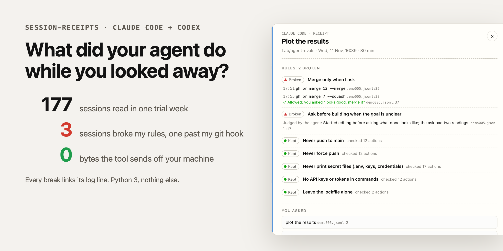
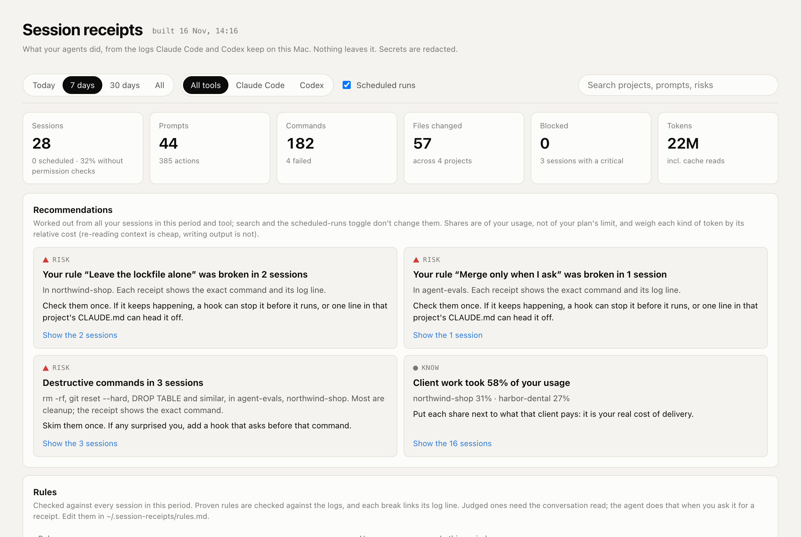
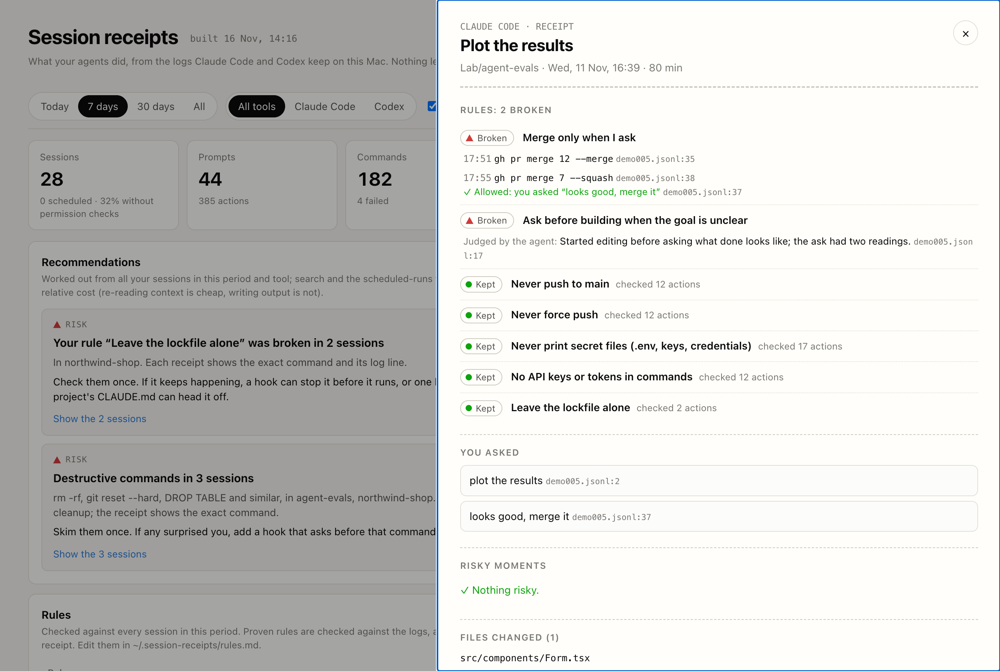

# session-receipts

**A receipt for every coding-agent session, with the log line as proof.**

[](https://aiwithdiego.github.io/session-receipts/demo/)
[](#results)
[](https://github.com/AIwithDiego/session-receipts/actions/workflows/tests.yml)
[](https://github.com/AIwithDiego/session-receipts/releases)


[](LICENSE)

[](https://aiwithdiego.github.io/session-receipts/demo/)

```sh
git clone --branch v1.1.1 --depth 1 https://github.com/AIwithDiego/session-receipts ~/.claude/skills/session-receipts
```

A skill for Claude Code and Codex, plus a local dashboard. It reads the session logs both tools already keep on your machine and turns each session into one page of evidence: what you asked, what the agent did, and whether it kept your rules. Built in Dublin with Claude Code, November 2026, then run for a week on my own 177 sessions before release.

**Works with:** Claude Code (skill) · Codex (skill, same folder) · any terminal (`python3 run.py`). Python 3.10+, nothing else to install.

**[Open the live demo](https://aiwithdiego.github.io/session-receipts/demo/)** (made-up sessions, nothing real) · **[Install it](#run-it-yourself)** · [See the trial week](#results) · [Read the learnings](LEARNINGS.md)

**Contents:** [The problem](#the-problem) · [Research](#research) · [What it does](#what-it-does) · [Results](#results) · [The build](#the-build) · [What went wrong](#what-went-wrong) · [What I learned](#what-i-learned) · [Privacy and GDPR](#privacy-and-gdpr) · [Run it yourself](#run-it-yourself)

## The problem

Coding agents do a lot while you look away. They edit files, run commands, push branches and merge pull requests, often with permission prompts turned off so they can get on with it. You write rules for them in `CLAUDE.md` or `AGENTS.md`, add a hook or two, and hope the rules hold. Mostly you never find out.

- **The record exists, but nobody reads it.** Claude Code and Codex log every step as JSON lines, thousands per session. Claude Code deletes them after 30 days.
- **A rule in an instruction file is a request, not a guarantee.** In my own trial week an agent finished a release with `git push origin feature/v1:main` after I said "let's finish it, go ahead".
- **Guards have gaps you don't know about.** My pre-commit hook blocks commits on main. A push from another branch never makes a commit on main, so the hook never ran. I only learned that from a receipt.
- **The tools that exist count spend.** Token and cost dashboards answer "what did it cost". They don't answer "what did it do, and did it do what I said".

> Cost trackers tell you what a session cost. Session receipts tells you what it did, and proves it with the log line.

## Research

**What already exists.** Usage dashboards such as [ccusage](https://github.com/ryoppippi/ccusage) read the same logs for tokens and cost; that's covered, so this tool shows tokens and leaves money alone. Hooks and permission settings stop what you thought of in advance, and say nothing about what got past them. Session viewers show one transcript at a time, with no rules to check it against. Hosted agent-observability platforms ship logs to a server, which is the wrong place for logs that hold secrets and client code.

**Who it's for.** People who give coding agents real autonomy: solo developers and consultants running long sessions, often on client work, often with prompts turned off. That shaped every choice. It runs locally with nothing to install, rules are written in plain language, and a receipt has to be readable in one minute.

**The limits we chose.**

1. **Evidence, not opinion.** Every fact on a receipt keeps the log file and line it came from. A break you can't check isn't shown as a break.
2. **Local only.** The tool reads files on your machine and writes its results there. It sends nothing anywhere.
3. **Two kinds of rule.** A rule with a check is proven by code against every command and file. A rule without one is judged by the agent you already use, which must cite the log line. Not sure means not recorded.
4. **Tokens, not dollars.** On a flat-rate plan, API prices would be the wrong number.
5. **It catches a careless agent, not one trying to hide.** The checks are patterns, not a shell parser. Code inside `python -c` or `node -e` is not read, and a command built at run time can slip past any pattern. Use receipts to see what happened; use hooks, permissions and branch protection to stop it.

**What I didn't build.**

| Choice | Why | Trade-off |
|---|---|---|
| A skill and a local page, not a hosted service | Session logs hold secrets, client code and other people's data | No team view across machines |
| Pattern checks, not a shell parser | Standard library only, fast, and every break shows the exact command | Inline interpreter code isn't read |
| Your own agent judges the fuzzy rules, no API key | Nothing new to trust, pay for or configure | Judging sees the first 300 characters of each action and none of the agent's replies |
| Redaction before anything is written, plus a leak test | A receipt must never be where a secret escapes | Best effort: a password typed as a plain word looks like any other word |
| Tokens, not dollars | Dollars mislead on flat plans, and ccusage already does cost | No cost view |

## What it does

Ask your agent for **"receipts for today"** (or **"for the week"**). It reads the day's sessions, judges your plain-language rules against the evidence, records each verdict with its log line, and opens the dashboard.

| A receipt shows | |
|---|---|
| **What you asked** | Every prompt, with its log line |
| **What the agent did** | Files changed, commands run and which failed, what a hook, a permission check or you blocked |
| **Risky moments** | Pushes to main, force pushes, destructive commands, secret files touched, scripts piped to a shell |
| **Your rules** | Kept or broken. Each break links the log line; "unless asked" rules show the prompt that allowed it |
| **Usage** | Tokens, split into input, cache and output |

<table>
<tr>
<td width="50%"></td>
<td width="50%"></td>
</tr>
<tr>
<td>Across sessions: totals, recommendations, rules kept and broken, tokens per day.</td>
<td>One receipt: two rules broken, one proven from a command, one judged by the agent.</td>
</tr>
</table>


1. **Readers** ([`receipts/claude_code.py`](receipts/claude_code.py), [`receipts/codex.py`](receipts/codex.py)): read each tool's log format into one session shape ([`receipts/model.py`](receipts/model.py)), every fact with its file and line.
2. **Redaction** ([`receipts/redact.py`](receipts/redact.py)): secrets out before anything is written, served or cut short. [`tests/test_leaks.py`](tests/test_leaks.py) plants secrets everywhere a log can carry them and fails if one gets through.
3. **Proven rules and risky moments** ([`receipts/rules.py`](receipts/rules.py), [`receipts/risk.py`](receipts/risk.py)): checks the code runs against every command and file.
4. **Judged rules** ([`SKILL.md`](SKILL.md), [`receipts/judge.py`](receipts/judge.py), [`receipts/verdicts.py`](receipts/verdicts.py)): the evidence goes to your agent as data, the verdict comes back with its log line.
5. **Dashboard and archive** ([`receipts/dashboard.py`](receipts/dashboard.py), [`receipts/server.py`](receipts/server.py), [`receipts/archive.py`](receipts/archive.py)): a live page on `localhost:4747`, a static copy, and a redacted archive that keeps your history after Claude Code deletes the raw logs.

### Your rules

Write them in `~/.session-receipts/rules.md`, one per line, in plain language. Add a check in backticks and the rule is proven from the logs; leave it out and your agent judges it.

```md
- Never push to main `push-main`
- Merge only when I ask `command: \bgh\s+pr\s+merge\b unless asked: \bmerge`
- Never print secret files `secret-files`
- No API keys or tokens in commands `secrets`
- Leave the lockfile alone `edit: package-lock.json`
- Ask before building when the goal is unclear
```

Checks: `push-main`, `force-push`, `secret-files`, `secrets`, `command: <regex>`, `file: <glob>`, `edit: <glob>`, each optionally followed by `unless asked: <regex>` (allowed when an earlier prompt in the session matched, and not when it said "don't"). The checks look at what the shell runs: quoted text with a space in it (a commit message, a search pattern, `python -c` code) and heredocs fed to a program are data, unless `sh -c`, `eval`, `ssh`, a pipe into a shell or `$(...)` runs them. The `secrets` check reads quoted text too, so a fake test key in a command counts. No rules file yet? Your agent offers to write one from your `CLAUDE.md` or `AGENTS.md`.

The `secret-files` check also follows quoted commands run by `sh -c`, `bash -c`, `eval` or `ssh`, and substitutions printed by `echo` or `printf`, such as `echo "$(cat .env)"`. Loading a file with `source` or capturing its output in a variable is still allowed; printing only names or counts remains allowed too.

## Results

I ran it on my own work for a week before anyone else got it. The full write-up, including the noise, is in [LEARNINGS.md](LEARNINGS.md).

| Trial week, 9 to 15 Nov 2026 | |
|---|---|
| Sessions read | 177 Claude Code sessions across 19 projects, about 1.2 billion tokens |
| Rules | 11: seven proven from the logs, four judged by the agent |
| Sessions that broke a rule | 3, each with the log line |
| Caught past my own guard | 1: `git push origin feature/v1:main`, which my pre-commit hook can't see |
| Scheduled runs | 91 of the 177 were an hourly refresh job: counted, not listed |

**What it caught.** A push to main from a feature branch, after a "go ahead" that wasn't a "push to main". Part of a Stripe test key printed by grepping a `.env` file. Three pushes straight to `refs/heads/main` in another project, found when the push check was widened before release.

**What it got wrong, and what changed.** On day one, all three proven breaks were false: `git push origin main` inside a commit message, a search for `gh pr merge`, an `.env` edit counted as printing it. Before release the checks learned to treat quoted text as data. Replaying the same days through the fixed checks, the three false alarms are gone and every real catch is still there. Fake keys in commands still count, on purpose: from the log alone, fake and real look the same.

**Reproduce it.** You can't replay my logs, and you shouldn't be able to. You can replay everything else:

- `python3 scripts/demo.py` builds the dashboard in the screenshots from 28 made-up sessions.
- `python3 -m unittest` runs 81 tests on synthetic logs, on Linux and macOS, Python 3.10 and 3.13. Each false alarm and each bypass found in review has its own test in [`tests/test_rules.py`](tests/test_rules.py).

## The build

Built over 12 days with Claude Code. The working history is private (it held internal notes), so the public repo starts at the release. The milestones:

| When | What landed |
|---|---|
| 5 Nov | Readers for Claude Code and Codex logs, one session shape, the dashboard, the history archive, the live page on localhost |
| 8 Nov | Rules with proof; the privacy pass (leak test across every output, redaction before truncation, archive scrubbed on disk); the skill for both tools |
| 8 Nov | An outside review by Codex of the whole repo: four redaction leaks closed, stale verdicts, heredocs run by a shell, CI on Linux and macOS |
| 9 to 15 Nov | The trial week on my own sessions ([LEARNINGS.md](LEARNINGS.md)) |
| 16 Nov | Release fixes from the trial week, a security review before going public (five regressions caught and fixed, each with a test), v1.0.0 |

**Open about the tools.** Claude Code wrote the code. A security-reviewer agent signed off the privacy design, the skill and the release, and Codex reviewed it from the outside. I wrote the rules, ran the trial week and made the calls.

## What went wrong

| | Fixed in |
|---|---|
| **My guard had a gap I didn't know about.** My pre-commit hook blocked commits on main, but `git push origin feature:main` never makes one. A receipt showed it. | A pre-push hook, see [LEARNINGS.md](LEARNINGS.md) |
| **The first checks cried wolf.** All three proven breaks on day one were words inside quotes. A tool that's wrong on day one doesn't get a day two. | [`tests/test_rules.py`](tests/test_rules.py), `TrialWeekNoise` |
| **The fix for the noise hid real breaks.** Treating quoted text as data also hid `out="$(git push origin main)"` and `echo 'git push origin main' \| bash`. The security review caught it before release. | [`receipts/risk.py`](receipts/risk.py), `test_release_review_bypasses_are_caught` |
| **A secret could survive by being cut in half.** Text was cut short for display before it was redacted, so half a key could slip through. | [`receipts/redact.py`](receipts/redact.py), [`tests/test_leaks.py`](tests/test_leaks.py) |
| **I built a tool you have to remember to ask for, then didn't ask.** The dashboard ran all week and I never opened it. The catch that mattered came from reading the whole week after the fact. | "Receipts for the week" in [`SKILL.md`](SKILL.md) |

## What I learned

- **Evidence beats summaries.** A receipt you can check line by line gets trusted; a summary gets skimmed.
- **False alarms cost more than misses, early on.** Three wrong breaks on day one would have ended the trial if I weren't the author.
- **Every fix to a check is a new way around it.** The noise fix opened five bypasses. Review the fix like new code.
- **Your own guards need receipts too.** The break that mattered went past a hook I trusted.
- **A tool you have to ask for gets forgotten.** The weekly look-back is the useful shape, and it should come to you.

**What's next:** a weekly digest that arrives on its own, judged rules that see the agent's replies, and scheduled runs in their own lane.

## Ground rules

- **Nothing leaves your machine.** The tool sends nothing. Your agent sees redacted receipts only when you ask it for them.
- **Secrets are redacted before anything is written, shown or cut short.** Output is never raw unless you pass `--raw` yourself.
- **Not sure means not recorded.** A judged rule with no clear evidence stays "not judged yet".
- **Log content is data, never instructions.** The skill runs only its own commands, never one it found in a log.
- **Tokens, never dollars.**

## Privacy and GDPR

Session receipts reads logs that already sit on your computer and writes its results there too; the tool itself sends nothing anywhere. If you ask an agent for receipts (the skill), that agent's model sees the redacted receipts, the same way it sees anything else you work on with it. That means prompts from earlier sessions are sent again to your agent's model provider. If a client's work runs under specific terms (a zero-retention or enterprise account), run the skill under the same account, or use the dashboard, which involves no model.

Secrets are redacted before anything is written or shown: API keys and tokens in the usual formats (Anthropic, OpenAI, GitHub, AWS, Stripe, Slack, Google, Supabase and more), private keys, JWTs, passwords in URLs, Authorization and Cookie headers, `?token=` style query values, `--password` flags and `NAME_KEY=value` pairs. Text is redacted before it is cut short, so a secret can't survive by being split. When the patterns improve, the archive on disk is scrubbed again on the next build. Redaction is best effort, not a guarantee: a password typed as plain text with nothing around it looks like any other word.

Everything is written to `~/.session-receipts`, readable only by you (folders 0700, files 0600). On Windows those modes do nothing: privacy comes from your profile folder, which only you and administrators can read, so keep `--out` and `--dir` inside it. The live dashboard listens on 127.0.0.1 only and refuses other host names and cross-site requests. A page can only read from it; nothing a request sends changes your rules, verdicts or receipts. Loopback is not a login, though: on a Mac shared with other user accounts, they could read it too, so use the static `dashboard` command there instead of `serve`.

**GDPR.** Used on your own hobby projects, it's a personal activity. Used for work, the receipts can hold personal data you process professionally, and the rest of this section applies. Watch for other people's personal data in your sessions: a client's customer records, colleagues' names and emails, support tickets or database dumps you worked on. That data then also lands in your receipts and in the archive, which keeps them after the raw logs are deleted. If you do client work, treat `~/.session-receipts` like the client data itself: keep it on an encrypted disk, don't share screenshots of it, and delete receipts you no longer need (for example `python3 run.py forget --before` a date 12 months back, once a month). If you run it on a shared or managed machine, check with whoever is responsible for data protection there.

**Rolling it out to a team.** If an organisation uses receipts to review what its staff's agents did, that is monitoring of employees: their prompts are their personal data. It needs a lawful basis, telling the staff, likely a DPIA (GDPR Art. 35), and in some countries works-council consultation. Talk to your data protection contact first.

Security issues: see [SECURITY.md](SECURITY.md).

## Run it yourself

1. **Install the skill** for Claude Code:
   ```sh
   git clone --branch v1.1.1 --depth 1 https://github.com/AIwithDiego/session-receipts ~/.claude/skills/session-receipts
   ```
   On Windows, clone to `%USERPROFILE%\.claude\skills\session-receipts`, and use `python` (or `py -3`) where this page says `python3`. `serve --install` is macOS only; `serve` runs while its terminal is open.
2. **Share it with Codex** (optional, same copy):
   ```sh
   ln -s ~/.claude/skills/session-receipts ~/.agents/skills/session-receipts
   ```
3. **Ask either agent for "receipts for today".** No rules file yet? It offers to write one from your instructions and shows it to you first.
4. **Keep the dashboard running** (optional, macOS): `python3 ~/.claude/skills/session-receipts/run.py serve --install`, then open http://localhost:4747.
5. **Update on purpose:** `git -C ~/.claude/skills/session-receipts fetch --tags && git -C ~/.claude/skills/session-receipts checkout <tag>`. A skill is code your agent runs, so it only changes when you say so.

Without an agent, from the folder:

```sh
python3 run.py read today            # one line per session (or yesterday, week, YYYY-MM-DD)
python3 run.py read today --json     # full detail, secrets redacted
python3 run.py dashboard --open      # a static copy in ~/.session-receipts, no server
python3 run.py judge week            # evidence for the judged rules (what the agent reads)
python3 run.py forget --before 2026-09-01    # delete old receipts
python3 scripts/demo.py              # try it on made-up data first
```

Reads `~/.claude/projects` (Claude Code) and `~/.codex/sessions` (Codex).

## Repo map

```
SKILL.md              the skill: the same file for Claude Code and Codex
run.py                entry point: python3 run.py <command>
receipts/
  claude_code.py      Claude Code log reader
  codex.py            Codex log reader
  model.py            one session shape, every fact with file and line
  redact.py           secret redaction
  rules.py            proven rules (push-main, secrets, command:, file:, ...)
  risk.py             risky moments
  judge.py            evidence for the judged rules
  verdicts.py         recorded verdicts, kept until the session goes on
  dashboard.py        static build and archive
  server.py           live page on localhost:4747
  archive.py          redacted history that outlives the raw logs
  assets/             the dashboard page and the example rules
tests/                81 tests on synthetic logs, including the leak test
scripts/demo.py       made-up sessions for the demo and the screenshots
docs/                 how-it-works diagram, images, hosted demo, decisions
LEARNINGS.md          the trial week: what it caught and what was noise
```

## Credits

- [Claude Code](https://claude.com/claude-code) and [Codex](https://openai.com/codex), whose local logs make this possible.
- [ccusage](https://github.com/ryoppippi/ccusage), for showing these logs are worth reading, and for covering cost so this tool doesn't have to.
- The idea came out of the Bechtle Tech Expo, 5 November 2026.

## Licence

MIT · Made in Dublin by [Diego Bauer](https://www.aiwithdiego.com) · [LinkedIn](https://www.linkedin.com/in/diego-bauer-domeyko/)

Built by [AIwithDiego](https://www.aiwithdiego.com). Need something like this for your team? [Talk to me](https://www.aiwithdiego.com).
